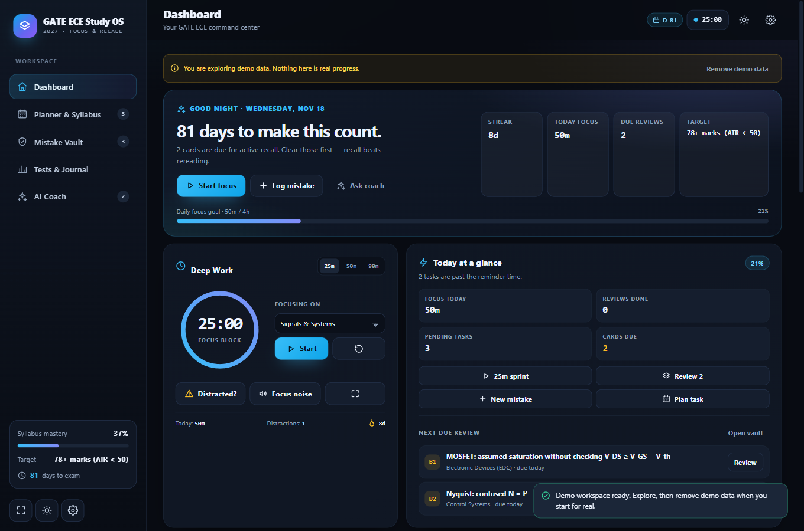

# GATE ECE Study OS

A focused, offline-first study command center for GATE ECE prep. Track the syllabus, review mistakes before they repeat, run deep-work sessions, drill flashcards, and analyse mocks — all in one responsive app.

Built as a dependency-free static site: plain HTML, CSS, and vanilla JavaScript. No build step, no CDN, no framework, no tracking.



---

## Quick start

Open `index.html` directly in a browser, or serve the folder locally (recommended, so IndexedDB and exports behave consistently):

```powershell
cd "C:\Gate Notes\Gate 2027 Registration"
python -m http.server 8765
```

Then visit <http://localhost:8765/>.

On first launch you can either start with a clean workspace or choose **Explore with demo** to load sample tasks, mistakes, cards, mocks, and journal entries. Demo data can be removed later from **Settings → Remove demo data** without losing your own syllabus progress.

---

## Features

### Dashboard
- Today's focus ring, streak, study-minutes summary, and a 7-day bar chart.
- Next actions: upcoming tasks/reminders, due flashcards, and recent mistakes.
- Subject-wise syllabus completion at a glance.
- Quick capture entry points for mistakes, tasks, and focus sessions.

### Focus timer
- Pomodoro-style work/break timer with configurable durations and presets.
- Distraction counter, session notes, and automatic study-minute logging.
- Full-screen focus mode with a built-in brown-noise masker and completion chime (Web Audio, no audio files).
- Timer state survives refresh and navigation; it keeps running when you leave focus mode.

### Syllabus matrix
- All 63 GATE ECE subtopics across 8 subjects: Networks, Signals & Systems, Electronic Devices, Analog Circuits, Digital Circuits, Control Systems, Communications, and Electromagnetics.
- Per-subtopic status: not started → learning → revised → confident.
- Revision counter and last-revised date, plus subject-level progress bars and overall completion.
- Filter by subject or search by topic; progress is preserved when demo data is removed.

### Mistake vault
- Log mistakes with subject, topic, source (test/book/lecture), severity, root cause, and the correct approach.
- Attach a screenshot or photo; images are compressed in-browser and stored in IndexedDB, keeping `localStorage` light.
- Search, filter by subject/severity/status, sort, edit, and delete with undo.
- Lightbox image preview and "mark resolved" workflow so only live gaps stay visible.
- Optional scheduling of resolved mistakes as spaced-repetition cards.

### Flashcards (SRS)
- Spaced repetition with Again / Hard / Good / Easy grading and automatic due dates.
- Create cards manually or promote a mistake into the deck.
- Review queue with keyboard-friendly controls and daily due counts on the dashboard.

### Mock tests
- Record test name, date, score, maximum marks, and per-subject breakdown.
- Score trend chart, accuracy summary, and subject-wise weak-area ranking.
- Edit and delete with undo.

### Planner and reminders
- Tasks with due dates, priorities, subject links, and completion state.
- Reminder times with in-app notifications (and optional browser notifications when permitted).
- Overdue and today buckets, plus a compact dashboard view.

### Journal
- Daily reflection entries with mood and wins/blockers.
- Chronological timeline with search and delete.

### AI coach (optional)
- Works fully offline with a built-in rule-based coach that reads your actual data: weak subjects, due cards, unresolved mistakes, and today's plan.
- Optionally connect a live model in **Settings → AI coach**:
  - **Google Gemini** with an API key (default model `gemini-2.5-flash`).
  - **Any OpenAI-compatible endpoint** with base URL, API key, and model (default `gpt-4o-mini`).
- Keys are stored only in this browser's `localStorage` and sent directly from your browser to the provider. If a live call fails, the coach falls back to offline mode with a clear notice.
- Quick prompts and one-click "turn this suggestion into a task".

### Settings
- Light/dark theme, profile name and target exam year.
- Timer and notification preferences.
- Export/import, demo data, and full reset.

### Data portability
- **JSON backup**: complete state export and round-trip import.
- **CSV**: mistakes, tasks, mocks, and study sessions for spreadsheets.
- **Markdown**: human-readable study report.
- Import validates and migrates legacy backup shapes, and keeps a pre-import snapshot for recovery.

---

## Data and privacy

Everything stays on your device. There is no backend, account, or analytics.

| What | Where |
| --- | --- |
| App state (tasks, syllabus, mistakes, mocks, journal, settings) | `localStorage` key `gateos.state.v2` |
| Onboarding flag, theme, timer, AI config | `localStorage` (`gateos.onboarded.v2`, `gateos.theme`, `gateos.timer`, `gateos.ai.config`) |
| Pre-import safety snapshot | `localStorage` key `gateos.preimport.backup` |
| Screenshots/photos | IndexedDB database `gateos.images` |

Notes:
- Browser storage is per-origin and per-browser profile. Opening the file directly (`file://`) versus serving over `http://localhost` creates separate stores.
- Clearing site data deletes your study history — export a JSON backup first.
- If `localStorage` fills up, the app warns you to export and prune old screenshots.

---

## Keyboard shortcuts

| Shortcut | Action |
| --- | --- |
| `Alt` + `Q` | Log a new mistake |
| `Alt` + `T` | Start / pause the timer |
| `Alt` + `F` | Toggle focus mode |
| `/` | Focus the vault search (when in the vault and not typing) |
| `Esc` | Close a dialog or leave focus mode |

---

## Responsive design

Verified with automated checks and visual review at 320, 390, 768, 1000, and 1440 px widths, with no horizontal overflow in any view. The layout moves from a bottom navigation bar on phones to a sidebar on desktop; dialogs become full-height sheets on small screens, and tables/charts reflow into stacked cards.

---

## Browser support

Current Chrome, Edge, Firefox, and Safari (desktop and mobile). Requires:
- ES2020+ JavaScript
- `localStorage` and IndexedDB (images degrade to an in-memory fallback if IndexedDB is unavailable)
- Web Audio for the chime and focus noise (optional; the rest works without it)

---

## Installable apps

Ready-to-share builds live in the `release` folder:

| Platform | File | Requirements |
| --- | --- | --- |
| Windows 10/11 (x64) | `GATE-ECE-Study-OS-Setup-2.0.0.exe` | ~98 MB download, ~350 MB installed |
| Android 7.0+ | `GATE-ECE-Study-OS-2.0.0.apk` | ~1.7 MB, works offline |

SHA-256 checksums for both files are in `release\SHA256SUMS.txt`, and short install instructions are in `release\README.txt` for sharing. Both binaries are also attached to the [Releases](https://github.com/Deva-2408/gate-ece-study-os/releases) page, so a download link can be shared without cloning the repository.

### Windows installer

1. Double-click `GATE-ECE-Study-OS-Setup-2.0.0.exe`.
2. Choose **Install for me only** and pick a folder (no administrator password needed).
3. Launch **GATE ECE Study OS** from the Start menu or desktop shortcut.

Windows SmartScreen will warn that the publisher is unknown because the installer is not code-signed. Choose **More info → Run anyway**. The installer and app are fully offline and contain no ads or telemetry.

- App data is stored in `%APPDATA%\GATE ECE Study OS` and is kept when you uninstall, so a reinstall or upgrade keeps your history.
- Uninstall from **Settings → Apps → Installed apps → GATE ECE Study OS**.
- Exports open a normal Windows **Save as** dialog.

### Android APK

1. Copy `GATE-ECE-Study-OS-2.0.0.apk` to your phone (USB, Drive, or send it to yourself).
2. Tap the APK. If prompted, allow **Install unknown apps** for the app you opened it from (Files/Chrome).
3. Install and open **GATE Study OS**.

Notes:
- The APK is signed with a self-signed release key. Android may show a Play Protect prompt for sideloaded apps; choose **Install anyway** only if you trust where the file came from.
- All data stays inside the app. Back up from **Settings → Data → Backup (JSON)** before uninstalling or switching phones.
- **Backups and reports** use Android's **Save as** picker; imports use the system file picker.
- The optional AI coach needs an internet connection and works with Gemini or any OpenAI-compatible HTTPS endpoint.

### Rebuilding

Windows (Node.js 20+):

```powershell
cd desktop
npm install
npm run dist
```

The installer is written to `desktop\dist\`. The first build downloads Electron and NSIS (~200 MB).

Android (JDK 17 + Android SDK 35):

```powershell
cd android
npm install          # only needed for icon regeneration
$env:JAVA_HOME = "C:\path\to\jdk-17"
$env:ANDROID_HOME = "C:\path\to\android-sdk"
.\gradlew.bat assembleRelease
```

The APK is written to `android\app\build\outputs\apk\release\`. Signing uses `android\keystore.properties` and `android\keystore\gateos-release.jks`; keep that keystore to ship updates that install over the old version.

---

## Project structure

```
Gate 2027 Registration/
├── index.html               # Markup for all views, dialogs, and the SVG icon sprite
├── assets/
│   ├── styles.css           # Design tokens, themes, layout, components, responsive rules
│   └── app.js               # State, persistence, rendering, timer, SRS, coach, imports/exports
├── desktop/                 # Electron shell + NSIS installer build
│   ├── main.js              # Secure app:// window, external links, native save dialog
│   ├── package.json         # electron-builder configuration
│   ├── build/               # Icon + installer license
│   └── scripts/             # Renderer copy, icon generation, packaged-app smoke test
├── android/                 # Native WebView shell + signed APK build
│   ├── app/src/main/        # MainActivity, manifest, resources, bundled web assets
│   ├── scripts/             # Web asset sync + launcher icon generation
│   └── keystore.properties  # Release signing config (local only, git-ignored)
├── release/                 # Install notes and checksums; binaries live on the Releases page
├── .gitignore
└── README.md
```

The web app itself still has no build step: edit `index.html`, `assets/styles.css`, or `assets/app.js` and reload. Rebuild the desktop/Android packages to pick up those changes.

---

## Verification

The web app was exercised end-to-end in headless Chrome against an isolated test origin:

- **272 automated checks passed** across onboarding, navigation, theme, tasks/reminders, syllabus, timer/presets/break/noise, vault CRUD + image compression + IndexedDB + lightbox + undo, SRS, mocks/chart, journal, offline and mocked live AI with failure fallback, settings, JSON/CSV/Markdown export, JSON round-trip and legacy/invalid imports, demo load/remove, reset, persistence, and responsive overflow.
- Live AI was validated against a local OpenAI-compatible mock; a real provider call requires your own API key.

Packaged builds:

- **Windows:** 18/18 smoke checks pass in the installed app, including `app://` storage, IndexedDB, onboarding, demo data, all five views, theme switching, 420 px layout, and persistence across relaunches. The installer was installed, launched, and uninstalled successfully, with working Start menu and desktop shortcuts.
- **Android:** APK verifies with v2 and v3 signatures and the expected package (`com.gateos.study`), minSdk 24, targetSdk 35, launchable activity, bundled web assets, and native save bridge. A physical device or emulator was not available in the build environment, so on-device UI was not exercised; the bundled UI is the same build that passed the 272 web checks.
